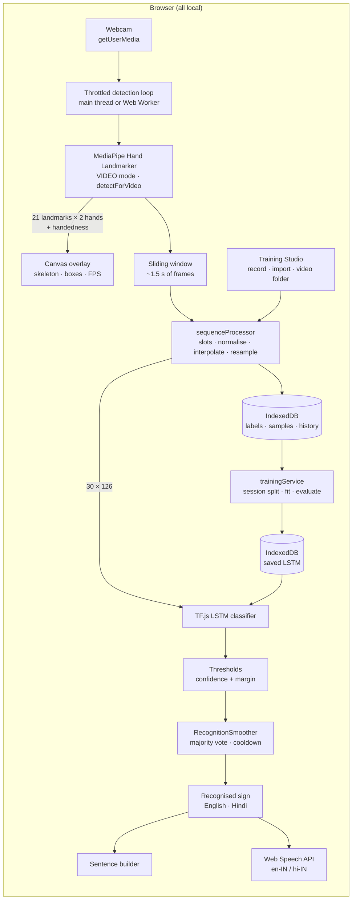
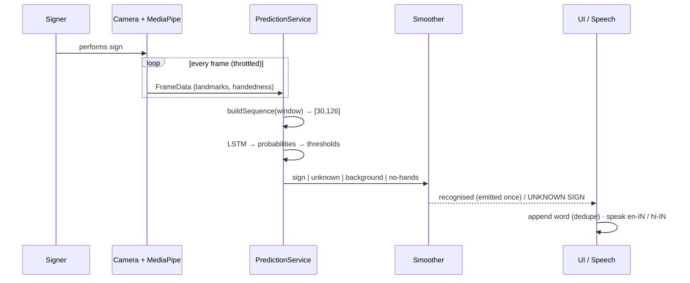

<div align="center">


# SignBridge

### Your Hands Have a Voice.

Open-source, real-time sign recognition and gesture-to-speech accessibility platform powered by MediaPipe and TensorFlow.js — focused on **Indian Sign Language (ISL)**.

[](.github/workflows/ci.yml)
[](LICENSE)


</div>

> **Research prototype.** SignBridge recognises a **limited vocabulary that you train yourself**. It is not a complete ISL translator and is not a substitute for a qualified interpreter.

---

## Contents

- [Overview](#overview) · [Problem](#problem-statement) · [Solution](#proposed-solution)
- [Architecture](#architecture) · [AI model](#ai-model) · [Recognition workflow](#recognition-workflow)
- [Installation](#installation) · [Webcam permissions](#webcam-permissions) · [Training](#training-your-vocabulary)
- [Dataset structure](#dataset-structure) · [Supported vocabulary](#supported-vocabulary) · [Limitations](#current-limitations)
- [Screenshots](#screenshots) · [Tech stack](#technology-stack) · [Licence](#licence-and-attributions) · [Roadmap](#roadmap) · [Contributing](#contributing)

## Overview

Someone stands in front of a laptop webcam and performs a sign. SignBridge then:

1. tracks up to two hands with **MediaPipe Hand Landmarker** (21 3-D landmarks per hand);
2. turns the last ~1.5 s of motion into a normalised **30 × 126** feature sequence;
3. classifies it with a **TensorFlow.js LSTM** trained in the browser on the user's own recordings;
4. accepts the result only if it is confident and stable, then shows the English word and its Hindi translation;
5. speaks it aloud (Indian English `en-IN` or Hindi `hi-IN`) and appends it to a sentence.

Everything runs locally: no paid APIs, no cloud inference, no uploaded video.

## Problem statement

India's Deaf and hard-of-hearing community relies on ISL, but certified interpreters are scarce. Everyday interactions at a counter, a clinic or in a classroom often have no shared language. Most sign-recognition demos either target American Sign Language, rely on cloud APIs, or report accuracy figures that cannot be reproduced.

## Proposed solution

A transparent, privacy-first toolkit that anyone with a laptop can run:

- **Training Studio**: record your own ISL vocabulary (English + Hindi + category), train and evaluate a sequence model with honest, session-held-out metrics.
- **Live Translator**: real-time recognition with confidence thresholds, unknown-sign rejection, temporal smoothing and repeat cooldowns.
- **Speech & sentences**: browser speech synthesis in English and Hindi, with a sentence builder and conversation history.
- **Sign Library**: a searchable vocabulary with references to the official ISLRTC dictionary.
- **Generic gesture demo**: MediaPipe's stock gesture recogniser, clearly labelled **GENERIC GESTURE DEMO — NOT ISL TRANSLATION**.

## Architecture



Source layout:

```
src/
  ai/            handLandmarker, landmarkNormalizer, sequenceProcessor, lstmClassifier,
                 trainingService, predictionService, gestureRecognizer, videoExtractor
  services/      cameraService, speechService, databaseService, vocabularyService
  workers/       handLandmarker.worker.ts (optional off-main-thread inference)
  hooks/         useCamera, useHandTracking, useSpeech, useDetectors, useAppContext
  components/    Camera/ Translator/ Speech/ Dashboard/ Common/
  pages/         Landing, Dashboard, LiveTranslator, TrainingStudio, SignLibrary,
                 SentenceBuilder, Settings, About
scripts/         download-models.mjs, verify-models.mjs, extract_video_landmarks.py
tests/           Vitest + React Testing Library suites
```

## AI model

**Input**: `[30, 126]` = 30 frames × (2 hands × 21 landmarks × xyz).

**Feature preprocessing** (`src/ai/sequenceProcessor.ts`, `src/ai/landmarkNormalizer.ts`):

| Step | Detail |
| --- | --- |
| Hand slots | Slot 0 = `Right`, slot 1 = `Left` as labelled by MediaPipe. Two hands labelled with the same side are resolved by confidence. |
| Normalisation | Landmarks 1–20 are wrist-relative and divided by palm size (mean of four palm bones). **Orientation is preserved** (no rotation), since it carries meaning in signing. |
| Temporal movement | The wrist slot (landmark 0) stores the wrist trajectory relative to the hand's first position in the window, scaled by median palm size. |
| Missing hands | Zero padding plus a `validity` mask (`[30, 2]`). A present hand is never all-zero, so padding is unambiguous. Gaps of ≤ 4 frames are linearly interpolated. |
| Resampling | Variable-length capture → exactly 30 frames by linear interpolation over time. |
| Rejection | Sequences with < 60 % of frames containing a hand are rejected. |

**Network** (`src/ai/lstmClassifier.ts`):

```
Input(30, 126) → LSTM(64) → Dropout(0.3) → Dense(64, ReLU) → Dropout(0.3) → Dense(N, softmax)
Adam(1e-3), categorical cross-entropy, N = number of trained signs (rebuilt per vocabulary)
```

**Training** (`src/ai/trainingService.ts`): exact duplicates are removed first. Then **whole recording sessions** are held out per sign for validation (falling back to a sample-level split, and saying so in the UI, when a sign has only one session). Optional jitter/scale augmentation applies to the training split only. Metrics shown are the real per-epoch values from `model.fit`, plus a confusion matrix and per-class precision/recall on the held-out set. Models are saved to IndexedDB (`indexeddb://signbridge-isl-classifier`) with metadata including a dataset version hash.

**Inference** (`src/ai/predictionService.ts`): every ~150 ms the last ~1.5 s of frames is classified. A prediction is accepted only if confidence ≥ threshold (default 80 %) **and** the margin over the runner-up ≥ 25 %; otherwise the UI shows **UNKNOWN SIGN**. A sign is emitted once 4 of the last 6 windows agree. It is then suppressed while held and re-armed when the hands drop, another sign is emitted, or the signer clearly moves on (subject to a cooldown). An optional **Background** class teaches the model what "not signing" looks like and is never spoken.

## Recognition workflow



## Installation

Requirements: **Node.js 20+** and a recent Chromium-based browser, Firefox or Safari with a webcam.

```bash
git clone https://github.com/<your-account>/signbridge-isl.git
cd signbridge-isl
npm install
npm run models:download   # official MediaPipe models + WASM runtime → public/ (≈16 MB + 31 MB, git-ignored)
npm run models:verify
npm run dev               # http://localhost:5173
```

Other scripts: `npm run lint`, `npm run typecheck`, `npm test`, `npm run build`, `npm run preview`.

## Webcam permissions

- The camera only works on **`http://localhost`** or **HTTPS** (browser secure-context rule).
- Press **Start camera** and allow access in the browser prompt. If you denied it earlier, click the camera icon in the address bar (Chrome/Edge) or *Site settings → Camera*, choose **Allow**, then press **Try again**.
- The app shows specific messages for denied permission, missing camera, camera in use, and unsupported browsers.
- **Privacy**: frames are processed in memory and never stored or uploaded. Only the landmark numbers you explicitly record are saved, in IndexedDB on your device. *Settings → Delete all local data* wipes everything.

## Training your vocabulary

1. Learn the sign from an authoritative source, e.g. the [ISLRTC dictionary](https://divyangjan.depwd.gov.in/islrtc/), or ideally a Deaf ISL signer.
2. In **Training Studio**, create a label: English word, Hindi translation, category and reference link.
3. Start the camera, pick the label and press **Record sample** (or <kbd>Space</kbd>). A 3-2-1 countdown runs, then a red REC frame captures ~1.5 s.
4. Record **20–30+ samples per sign**. Press **New session** whenever you change lighting, position, clothing or signer; validation holds out whole sessions.
5. Add a **Background** label (category "Background") with resting hands and fidgeting. This reduces false positives a lot.
6. Press **Train model** (needs ≥ 2 signs with ≥ 4 samples each). Watch the live accuracy/loss curves.
7. Press **Evaluate** for the confusion matrix, and **Test with new recording** for an unsaved one-off check.
8. Open **Live Translator**. Retrain whenever you add samples (the app flags outdated models).

Use **Export JSON** / **Import JSON** to back up or share landmark datasets (no video is included).

## Dataset structure

**Locally supplied videos** (optional). Use **Import video folder** in the Training Studio and pick the top folder:

```
dataset/
  HELLO/
    sample_001.mp4
    sample_002.mp4
  THANK_YOU/
    sample_001.mp4
  HELP/
    sample_001.mp4
```

Each video is decoded in the browser, run through the Hand Landmarker frame by frame, and converted with the **same** preprocessing as webcam recordings. Each video becomes its own session. Folder names become labels (`THANK_YOU` → "THANK YOU"). Alternatively run `scripts/extract_video_landmarks.py` (Python + MediaPipe) and import its JSON.

**Exported dataset JSON** (`format: "signbridge-dataset"`): `labels[]` plus `samples[]` with `frames` (30 × 126), `validity` (30 × 2), `sessionId`, `source`.

See [docs/DATASETS.md](docs/DATASETS.md) for the external ISL datasets we evaluated, their licences, and a safe small-subset workflow. **No dataset is downloaded automatically** (INCLUDE alone is ~57 GB).

## Supported vocabulary

**No ISL signs are pre-trained or bundled.** The vocabulary is whatever you train.

To save typing, **Sign Library → Add vocabulary packs** loads 277 ready-made words with Hindi translations, each linked to the ISLRTC dictionary: the fingerspelling alphabet (A–Z), numbers, greetings, questions, family, needs, food, feelings, health and emergency, actions, time and days, colours, and places (`src/data/vocabularyPacks.ts`). These are **words only**. A sign is recognised only after you learn it, record 20–30 samples, and retrain. Start with a handful of signs and grow from there; more classes need more data per class to stay accurate. The generic gesture demo recognises MediaPipe's 7 stock gestures (thumbs up/down, open palm, closed fist, pointing up, victory, "I love you" hand shape). These are **not** ISL words.

## Current limitations

- Isolated signs only. No continuous signing, ISL grammar, facial expressions or other non-manual markers.
- Hand landmarks only (no body pose), so signs that depend on location relative to the face or body are harder to tell apart.
- Accuracy depends entirely on your data. A softmax classifier can be confidently wrong on unseen signs; train a Background class and keep thresholds high.
- Models trained by one signer may not generalise to others. Collect data from several signers.
- Hindi speech depends on an installed `hi-IN` voice. Without one, SignBridge speaks the English word and says so.
- The Web Worker engine runs MediaPipe on the CPU delegate. The main-thread GPU engine is usually faster.
- No end-to-end camera tests (webcams cannot be automated reliably in CI). Camera, speech and storage are covered by unit and component tests with mocks.

## Screenshots

No genuine screenshots or demo GIF of real ISL recognition are included yet: the project ships without a trained ISL model, and we will not publish staged results. Contributions of real, consented demo recordings are welcome.

## Technology stack

| Layer | Technology |
| --- | --- |
| UI | React 18, TypeScript, Vite 5, Tailwind CSS 3, Lucide React, React Router 6 |
| Hand tracking | `@mediapipe/tasks-vision` Hand Landmarker (VIDEO mode), optional Web Worker |
| Recognition | TensorFlow.js 4 Layers API: custom LSTM, trained and run in the browser |
| Generic demo | MediaPipe Gesture Recognizer |
| Speech | Web Speech API `SpeechSynthesisUtterance` (en-IN, hi-IN) |
| Storage | IndexedDB (`idb`), TF.js IndexedDB model storage, JSON import/export |
| Quality | Vitest, React Testing Library, fake-indexeddb, ESLint, GitHub Actions |

## Licence and attributions

- SignBridge source code: **Apache License 2.0**, see [LICENSE](LICENSE).
- Third-party packages, model assets and dataset licences: [THIRD_PARTY_NOTICES.md](THIRD_PARTY_NOTICES.md). MediaPipe models are downloaded from Google by the setup script and **not redistributed** here.
- Sign references: Indian Sign Language Research and Training Centre (ISLRTC), Govt. of India. Linked, not copied.

## Roadmap

- [ ] Add MediaPipe Pose/Face landmarks for location-dependent signs and non-manual markers
- [ ] Open-set recognition (e.g. distance-based rejection) beyond softmax thresholds
- [ ] Shareable, consented, properly licensed community ISL landmark datasets
- [ ] Transformer / TCN classifiers and on-device model comparison
- [ ] Continuous signing with segmentation
- [ ] Playwright smoke tests with a fake media stream
- [ ] More Indian languages for output (Tamil, Bengali, Marathi, …)
- [ ] PWA / offline install

## Contributing

Contributions from Deaf signers, ISL interpreters, researchers, designers and developers are very welcome. Please read [CONTRIBUTING.md](CONTRIBUTING.md) and the [Code of Conduct](CODE_OF_CONDUCT.md). Report security issues privately as described in [SECURITY.md](SECURITY.md).

**Suggested GitHub topics:** `sign-language` `indian-sign-language` `computer-vision` `mediapipe` `tensorflow-js` `accessibility` `gesture-recognition` `machine-learning` `open-source`
